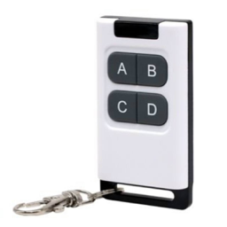

# Jiuhao CDWX8 Remote for Home Assistant

久豪 CDWX8 四鍵遙控器的 Home Assistant 自訂整合。安裝後在 HA 開啟按鍵自動偵測，按一下遙控器，HA 就會從 BLE 廣播讀取 MAC 位址和 UUID 前綴。每支遙控器獨立設定，無須藍牙配對。

## 安裝與使用

1. 在 HACS 加入本 repo，選擇 **Integration** 類型。開啟 **Jiuhao CDWX8 Remote**，下載後重啟 Home Assistant。
2. 在 **設定 → 裝置與服務 → 增加整合** 搜尋 **Jiuhao CDWX8 Remote**，選 **按鍵自動偵測**。
3. 在提示出現後按一下任一實體按鍵，核對畫面顯示的 MAC，再確認新增。

每支遙控器提供 A–D 四個事件實體和四個可點按的虛擬按鈕。實體按鍵和 HA 裡的虛擬按鈕會送出同樣的事件，可以共用自動化。適用於已啟用 Bluetooth 整合、且接收器可提供原始 BLE 廣播的 Home Assistant Core 2026.10.2 或更新版本。 [完整安裝指南](docs/installation.md) · [回報問題](https://github.com/vincent97277/ha-cdwx8-remote/issues)

## 授權

程式碼與文件採 MIT 授權。圖示使用提供的遙控器照片，照片的權利由原權利人保留。 [MIT License](LICENSE)
